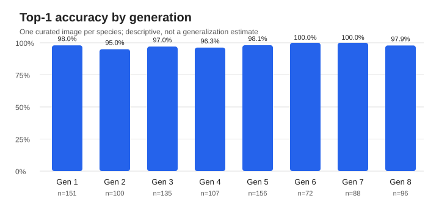

# Pokédex

A small web app that identifies a Pokémon from an uploaded image. A FastAPI service runs a pre-existing image classification model; the static frontend then fetches species data from PokéAPI and presents it in a vertical Pokédex carousel.

[](https://developer.mozilla.org/docs/Web/JavaScript)
[](https://www.python.org/)
[](https://fastapi.tiangolo.com/)
[](https://pytorch.org/)
[](https://huggingface.co/)
[](https://pages.github.com/)

## Demo

[Open the GitHub Pages frontend](https://cosmicsheep42.github.io/Pokedex/). Classification depends on a separate Hugging Face Space that may need time to wake after inactivity.

<!-- Add a screenshot or short GIF here after capturing one from the deployed app. -->

## Features

- Image upload with format and 10 MB size checks
- Pokémon prediction, description, types, base stats, and sprite gallery
- Normal and shiny sprite toggle when both images are available
- Keyboard accessible upload controls, responsive layout, and recoverable error messages

## Tech stack

- **Frontend:** HTML, CSS, JavaScript ES Modules; static hosting on GitHub Pages
- **Backend:** Python, FastAPI, Pillow, PyTorch, Hugging Face Transformers; Docker Space on Hugging Face
- **Model:** [`skshmjn/Pokemon-classifier-gen9-1025`](https://huggingface.co/skshmjn/Pokemon-classifier-gen9-1025), a ViT image classifier published by `skshmjn`
- **Data:** [PokéAPI](https://pokeapi.co/) for Pokémon and species information

## Architecture

```text
Image → FastAPI /classify → ViT prediction → Pokémon name
     → PokéAPI /pokemon/{name} → /pokemon-species/{species}
     → Pokédex carousel
```

`main.js` owns UI state and upload events. `scripts/core/` handles requests, label normalization, and API contracts. `scripts/modules/` renders the existing slides. The backend validates and decodes the image before inference. The browser makes PokéAPI requests directly.

## Project structure

```text
index.html, imports.css, config.js    Static entry point, styles, API configuration
scripts/main.js                        UI coordination
scripts/core/                          HTTP, classification, PokéAPI, errors, names
scripts/modules/                       Upload and result slide renderers
scripts/UI/                            Carousel, drag scroll, colors, safe HTML
styles/                                Pokédex styles and type icons
tests/                                 Frontend tests using Node's test runner
backend/                               Hugging Face Space Git submodule
  app.py, Dockerfile, requirements.txt FastAPI inference service
  test_app.py, requirements-test.txt   API tests without downloading the model
.github/workflows/checks.yml          Frontend CI checks
```

## Local development

Clone with the backend submodule:

```bash
git clone --recurse-submodules https://github.com/CosmicSheep42/Pokedex.git
cd Pokedex
python3 -m http.server 5173
```

Open `http://localhost:5173`. The frontend uses the deployed backend by default. No Node install is needed to serve it; Node 20 or newer is needed for tests.

To run the backend locally, install its dependencies in a Python virtual environment, then start Uvicorn:

```bash
cd backend
python3 -m venv .venv
.venv/bin/pip install -r requirements.txt
.venv/bin/uvicorn app:app --host 127.0.0.1 --port 8000
```

Change `BACKEND_URL` in the root `config.js` to `http://127.0.0.1:8000/classify` while developing locally. The first backend start downloads and loads the model, so it needs internet access, RAM, and additional disk space. Restore the deployed URL before publishing the static frontend. Local development origins on ports 5173 and 5500 are listed in backend CORS settings.

## Machine learning

The backend integrates the existing model published by `skshmjn`; this project does not claim to have trained or fine-tuned it. The model card describes it as a ViT classifier for up to 1,025 Pokémon species. The service opens the uploaded image with Pillow, checks its dimensions, converts it to RGB, applies `ViTImageProcessor.from_pretrained`, and runs `ViTForImageClassification` in inference mode. It maps the highest logit to a label and returns `pokemonName` plus up to five candidates with `modelScore` values derived from softmax. These scores are **not calibrated probabilities**. The frontend currently uses only `pokemonName`.

The model may misclassify unusual artwork, partial subjects, multiple Pokémon, or images outside its training distribution. The deployed API was evaluated against WTP-Bench; measured results and the reproduction steps are below. This is a reference benchmark, not a verified held-out test set.

### WTP-Bench evaluation (2026-11-04)

The run used all **905 base species** from Generations 1–8 in the pinned [WTP-Bench revision](https://github.com/eternal-f1ame/WTP-Bench/tree/5e96847cbabb1da6e28d85bae672f8f4e247322e), with one official high quality artwork image per species. The benchmark sent the images to the deployed `/classify` API and scored species IDs, so generic model labels for default forms count as the same species.

WTP-Bench contains official artwork and silhouette variants. This run selected only high quality artwork for base species; it did not score alternate forms. The preparation command records each source, label, and image SHA-256 in a manifest. Inference records the API response, prediction, status, retries, and client-side latency for each image. The warm-up request is recorded separately and excluded from the per-image latency metrics.

| Metric | Measured result |
|---|---:|
| Top-1 | **97.7%** (884/905 successful responses) |
| API failures | **0/905** (0%) |
| Top-5 | **N/A**; the deployed API did not return five usable candidates |
| Client latency p50 / p95 | **1,750 ms / 3,429 ms** |

| Generation | Top-1 | Correct / total |
|---|---:|---:|
| 1 | 98.0% | 148/151 |
| 2 | 95.0% | 95/100 |
| 3 | 97.0% | 131/135 |
| 4 | 96.3% | 103/107 |
| 5 | 98.1% | 153/156 |
| 6 | 100.0% | 72/72 |
| 7 | 100.0% | 88/88 |
| 8 | 97.9% | 94/96 |

The 21 remaining mistakes were mostly confusions between nearby evolution stages, including Arcanine→Growlithe, Cubone→Marowak, and Porygon-Z→Porygon. The reported Top-1 uses the benchmark's species-level label mapping. The 95% Wilson interval is 96.5%–98.5% under a simplified binomial assumption.

Top-1 is correct species predictions divided by successful responses. Failures are reported separately and count as misses in end-to-end accuracy. Top-5 is calculated only when the API returns five valid candidates. Latency is measured on the client and includes network and retries; p50/p95 use successful image requests. The Wilson interval is a binomial approximation and does not account for possible dependence between images or overlap with training data.



Results: [full report](evaluation/results/report.md), [all predictions](evaluation/results/predictions.csv), [metrics JSON](evaluation/results/metrics.json), [per-generation CSV](evaluation/results/per_generation.csv), and [error list](evaluation/results/failures_and_misclassifications.csv). No Pokémon images are committed; `prepare` downloads them locally when reproducing the run.

See the detailed [evaluation methodology](evaluation/docs/METHODOLOGY.md) and [dataset provenance and rights](evaluation/docs/DATASET_AND_RIGHTS.md). The automated benchmark tests use a local simulated API to test the tool's behavior; they do not measure model quality.

#### Limitations

WTP-Bench contains curated official artwork that may overlap the model's training data; the training set is unavailable, so independence cannot be claimed. Each species has one image, so this run does not establish accuracy on photographs, user uploads, other art, or different poses. It covers generations 1–8 only, not all 1,025 model classes. The deployed API response supported Top-1, but did not provide five usable candidates for Top-5 scoring. The service did not expose its exact model revision, so the result identifies the endpoint and run time, not a verified model artifact. Softmax scores are not calibrated probabilities. Latency includes network and retry time, not just model inference.

#### Reproduce

Requires Python 3.10+ and network access. From the repository root:

```bash
cd evaluation
python3 -m unittest discover -s tests -v
python3 -m benchmark prepare --all-base --image-mode hq
python3 -m benchmark run --backend api \
  --url https://cosmicsheep42-backend.hf.space/classify
python3 -m benchmark report
```

The first command uses a local stub only to test the benchmark; it produces no model metrics. The other commands download the pinned dataset to `evaluation/dataset/images/` and classify all 905 images against the live service. Do not commit or redistribute that image directory. See the [benchmark methodology](evaluation/docs/METHODOLOGY.md) and [dataset rights](evaluation/docs/DATASET_AND_RIGHTS.md).

To run inference with the published model locally instead of the hosted API, install `evaluation/requirements-local.txt`, then replace the API run command with:

```bash
python3 -m benchmark run --backend local \
  --model skshmjn/Pokemon-classifier-gen9-1025
```

Local inference downloads the model weights and may require substantial memory and disk space. Record the backend used when comparing runs.

## Testing

```bash
npm test
npm run verify
```

These commands use Node's built-in test runner, check the frontend entry point, and parse the backend source. Frontend tests mock network calls and cover normalization, HTTP errors, timeouts, classifier and PokéAPI contracts, upload validation, and optional rendering data. No build step is required.

Backend API tests use lightweight dependencies and stub inference, so they do not download the model:

```bash
python3 -m venv .venv-test
.venv-test/bin/pip install -r backend/requirements-test.txt
.venv-test/bin/python -m unittest discover -s backend -p 'test_*.py'
```

GitHub Actions runs `npm run verify` on pushes and pull requests. Backend tests should also run in CI after the separate backend submodule changes are published and its Git pointer is updated in this repository.

## Deployment

The frontend is hosted on GitHub Pages. The backend is a [Hugging Face Docker Space](https://huggingface.co/spaces/CosmicSheep42/backend), tracked here as a Git submodule. Changes inside `backend/` belong to that separate repository and require their own commit and deployment before the hosted API changes. A sleeping Space or cold model load can delay the first classification; the frontend waits up to 90 seconds and then shows a retryable message. Neither service is assumed to be continuously available.

## Credits and license

Pokémon data and sprite URLs: PokéAPI and its linked asset sources. Classifier: [`skshmjn/Pokemon-classifier-gen9-1025`](https://huggingface.co/skshmjn/Pokemon-classifier-gen9-1025) (Apache 2.0 model card). Bundled type icons are present in `styles/types/`; their original source and reuse terms are not documented in this repository and should be confirmed before broader redistribution. Project code: [MIT License](LICENSE).
