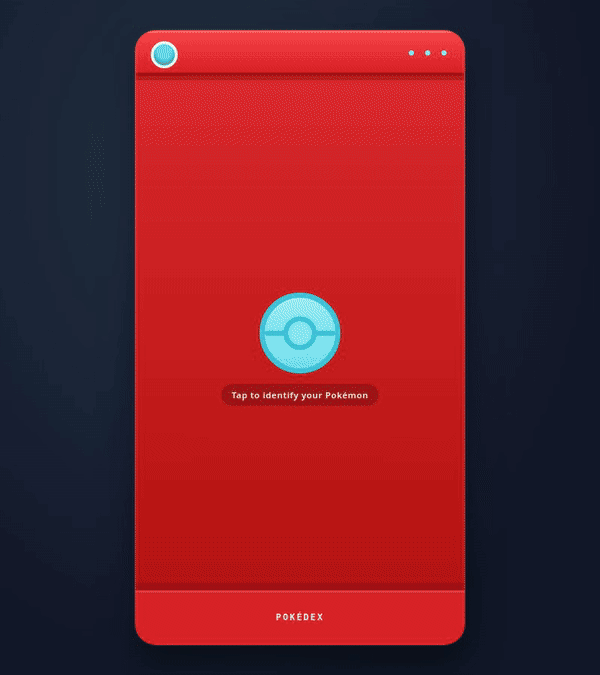

# Pokédex

A browser app that identifies a Pokémon in an uploaded image and displays its PokéAPI species data, stats, and sprites. The frontend and classifier are separate services; this project integrates a third-party model and does not train or fine-tune it.

[](https://developer.mozilla.org/docs/Web/JavaScript) [](https://www.python.org/) [](https://fastapi.tiangolo.com/)

## Demo

[Open the GitHub Pages app](https://cosmicsheep42.github.io/Pokedex/). The Hugging Face Space may take time to wake after inactivity.

## Showcase

The short walkthrough below follows the main user journey: upload an image, review the identified Pokémon, and explore the available data views.

[](pokedex-showcase.gif)

It highlights the Overview, Stats, Biology, Forms, and Sprites sections, including the enlarged sprite viewer. The recording uses the sample image `b.webp` and the deployed classifier API; the result can vary if the service is waking up or receives a different model response.

## Features

- Upload image classification with file type and 10 MB size validation.
- Pokémon species details, types, base stats, sprites, and a shiny toggle where available.
- Responsive, keyboard-operable interface with recoverable request errors.

## Tech stack

- **Frontend:** HTML, CSS, JavaScript ES modules, hosted on GitHub Pages.
- **Classifier API:** FastAPI, PyTorch, Transformers, and Pillow, hosted as a Hugging Face Docker Space.
- **Model:** [Pokémon Classifier Gen9](https://huggingface.co/skshmjn/Pokemon-classifier-gen9-1025), a third-party Vision Transformer; its weights revision used for evaluation is recorded in the [run metadata](evaluation/results/definitive-2026-11-04/run_metadata.json).
- **Pokémon data:** [PokéAPI](https://pokeapi.co/).

## Architecture

```text
Image upload → FastAPI /classify → model prediction (pokemonName)
             → PokéAPI /pokemon-species/{name}
             → default variety → PokéAPI /pokemon/{variety}
             → Pokédex carousel
```

The browser calls the classifier and PokéAPI directly. The `backend/` directory is a Git submodule pointing to the separate Hugging Face Space repository; changing its pointer here does not deploy the Space. The backend code revision and model weights revision are tracked separately in benchmark metadata.

## Model evaluation

The definitive run evaluated one official WTP-Bench high-quality illustration for each of **905 base species across Generations 1–8**. It measured recognition of curated official illustrations, not general accuracy on user-uploaded photographs or artwork.

| Top-1 | Top-5 | Request failures | Client latency p50 / p95 |
|---:|---:|---:|---:|
| **97.7%** (884/905) | **100%** (905/905) | **0/905** | **2.10 s / 5.22 s** |

These are measured results from the deployed API, not test-fixture results. WTP-Bench is not proven independent of the model's training data. With one image per species, the score does not establish performance on varied user images. See the [complete report](evaluation/results/definitive-2026-11-04/report.md) for generation breakdowns, per-sample errors, hashes, and execution details. Softmax scores are not calibrated probabilities.

## Getting started

```bash
git clone --recurse-submodules https://github.com/CosmicSheep42/Pokedex.git
cd Pokedex
npm start
```

Open `http://localhost:5173`. Serving the static frontend requires Python 3; no package installation is needed. The app uses the deployed classifier by default. For local backend instructions, including model download requirements, see [`backend/README.md`](backend/README.md).

## Testing

From the repository root, run frontend tests and checks:

```bash
npm test
npm run verify
```

The benchmark tooling tests use fixtures and a simulated API; they test benchmark integrity and do not measure model quality. From `evaluation/`:

```bash
python3 -m unittest discover -s tests -v
```

Backend contract tests use stubbed inference and do not download model weights. Install `backend/requirements-test.txt`, then run from the repository root:

```bash
python3 -m pip install -r backend/requirements-test.txt
python3 -m unittest discover -s backend -p 'test_*.py' -v
```

To reproduce the real benchmark, from `evaluation/` prepare the pinned dataset and run against the live service. Use a new, empty output directory for each run:

```bash
python3 -m benchmark prepare --all-base --image-mode hq --seed 42
python3 -m benchmark run --backend api \
  --url https://cosmicsheep42-backend.hf.space/classify \
  --output-dir results/my-run
python3 -m benchmark report --output-dir results/my-run
```

Preparation downloads official images locally; they are excluded from Git and must not be committed or redistributed without permission. See the [methodology](evaluation/docs/METHODOLOGY.md) and [dataset provenance and rights](evaluation/docs/DATASET_AND_RIGHTS.md).

## Credits and limitations

The model is authored and published by [`skshmjn`](https://huggingface.co/skshmjn/Pokemon-classifier-gen9-1025); this project contributes the application integration, API client, and evaluation tooling. Pokémon data is provided by [PokéAPI](https://pokeapi.co/), and the benchmark source is [WTP-Bench](https://github.com/eternal-f1ame/WTP-Bench). Pokémon characters and artwork belong to their respective rights holders. The benchmark repository's software license does not itself grant rights to redistribute Pokémon artwork; no benchmark images are included here. The source and reuse terms for the bundled type icons are not documented in this repository. See [image provenance and rights](evaluation/docs/DATASET_AND_RIGHTS.md). Project source code is under the [MIT License](LICENSE).
