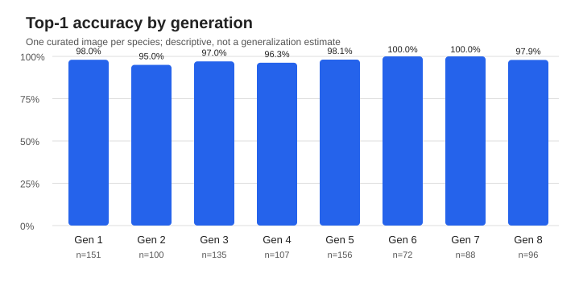

# Pokédex benchmark report

Run ID: `6d117900d8514423812cdb55a978a1a0`; scope: **complete**; started: 2026-11-04T20:46:50.224096+00:00

- Dataset: WTP-Bench (official artwork, Gen 1–8).
- Backend code revision: `46b504eef2168f5de16413473f4f09a641cebc36`; model: `skshmjn/Pokemon-classifier-gen9-1025`; weights revision: `9e8d54de136b99afc212322eae13ddc07a6fd779`.
- Samples attempted: **905**, successful: **905**, failed: **0**.
- Top-1 accuracy (successful requests): **97.7%** (884/905).
- End-to-end correct responses (failures counted as incorrect): **97.7%** (884/905).
- Top-5 accuracy: **100.0%** (905/905; coverage: 100.0% of successful responses).
- End-to-end latency p50/p95: **2102 ms / 5217 ms** (successes only; includes network and retries in API mode).

### Accuracy by generation

| Generation | Top-1 | Correct / successful | Failed |
|---|---:|---:|---:|
| 1 | 98.0% | 148/151 | 0 |
| 2 | 95.0% | 95/100 | 0 |
| 3 | 97.0% | 131/135 | 0 |
| 4 | 96.3% | 103/107 | 0 |
| 5 | 98.1% | 153/156 | 0 |
| 6 | 100.0% | 72/72 | 0 |
| 7 | 100.0% | 88/88 | 0 |
| 8 | 97.9% | 94/96 | 0 |

### Scope and limitations

This is a **reference benchmark** of a third-party pre-trained ViT model, not a verified held-out test. Official artwork might overlap the training images; the WTP-Bench dataset is not proven independent of training. It covers Generations 1–8 only, not all 1,025 classes. The benchmark measures species identification; alternative forms are not separately scored. Each species has one curated image, so results do not measure variation across images or real-world accuracy. Top-5 is reported only where the API supplies five candidates; model scores are not necessarily calibrated probabilities. The generation chart is descriptive and uses the same single-image-per-species sample; it is not evidence of generalization within each generation.

Reproducibility: [dataset source](https://github.com/eternal-f1ame/WTP-Bench), [evaluation code](../benchmark/), [predictions](predictions.csv), [metrics](metrics.json).

## Errors and misclassifications

The complete per-sample list, including expected species, prediction, generation, and sample ID, is in [failures_and_misclassifications.csv](failures_and_misclassifications.csv).

## Notes

The numeric score returned by softmax is not a calibrated probability of being correct.
Request failures are distinguished from classifier errors and excluded from model-only Top-1 accuracy.
This report was generated from predictions.csv; no manual scores were supplied.