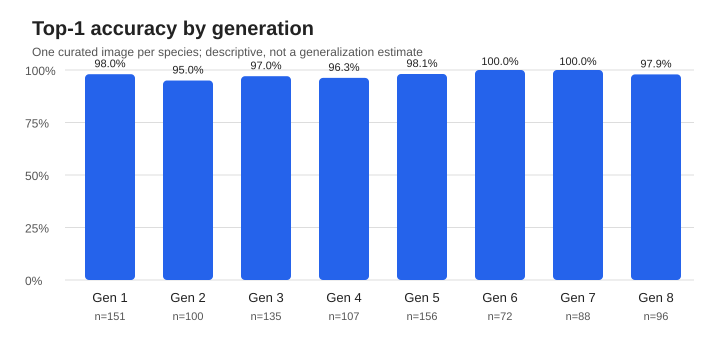

# Pokédex benchmark report

Benchmark executed: 2026-11-04T05:55:37.677518+00:00

**Legacy artifact:** this run predates the current run-integrity metadata and is rejected by the current report validator. Its raw predictions are retained; the summary below is historical and has not been revalidated by the current tooling.

## Image classification evaluation

- Dataset: WTP-Bench (official artwork, Gen 1–8).
- Samples attempted: **905**, successful: **905**, failed: **0**.
- Top-1 accuracy (successful requests): **97.7%** (884/905).
- End-to-end correct responses (failures counted as incorrect): **97.7%** (884/905).
- Top-5 accuracy: **not available** (API did not return five usable candidates).
- End-to-end latency p50/p95: **1750 ms / 3429 ms** (successes only; includes network and retries in API mode).

### Accuracy by generation

| Generation | Top-1 | Correct / successful | Failed |
|---|---:|---:|---:|
| 1 | 98.0% | 148/151 | 0 |
| 2 | 95.0% | 95/100 | 0 |
| 3 | 97.0% | 131/135 | 0 |
| 4 | 96.3% | 103/107 | 0 |
| 5 | 98.1% | 153/156 | 0 |
| 6 | 100.0% | 72/72 | 0 |
| 7 | 100.0% | 88/88 | 0 |
| 8 | 97.9% | 94/96 | 0 |

### Scope and limitations

This is a **reference benchmark** of a third-party pre-trained ViT model, not a verified held-out test. Official artwork might overlap training data; WTP-Bench is not proven independent of training. Coverage is Generations 1–8 only. Each species has one curated image, so the score does not estimate performance on images submitted by users or variation within a species. The generation chart is descriptive, not evidence of generalization within each generation. Softmax scores are not calibrated probabilities.

Reproducibility: [dataset source](https://github.com/eternal-f1ame/WTP-Bench), [evaluation code](../benchmark/), [predictions](predictions.csv), [metrics](metrics.json).

## Errors and misclassifications

The complete per-sample list is in [failures_and_misclassifications.csv](failures_and_misclassifications.csv).

## Notes

The numeric score returned by softmax is not a calibrated probability of being correct.
An API request failure is counted in end-to-end correct rate but excluded from model-only Top-1 accuracy.
This report was generated from predictions.csv; no manual scores were supplied.
